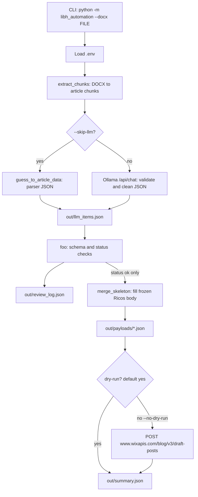

# Process flow

This project turns a Library Herald **data-entry DOCX** into Wix **draft blog posts**. It does not invent full papers. It splits each issue file into article records, optionally cleans them with a local LLM, validates them, then fills a frozen Wix JSON skeleton.

## End-to-end



Entry points:

- `python -m libh_automation --docx "..."` → [`libh_automation/__main__.py`](libh_automation/__main__.py)
- [`main.py`](main.py) is the same CLI
- Orchestration lives in [`libh_automation/pipeline.py`](libh_automation/pipeline.py)

Default flags: **dry-run on**, LLM **on** (unless `--skip-llm`).

## 1. Extract the DOCX

Module: [`libh_automation/extract.py`](libh_automation/extract.py)

The Word files are data-entry sheets, not formatted papers. Paragraph styles are empty, so the parser does **not** use Heading styles.

1. Read non-empty paragraphs with `python-docx`.
2. Keep the first three lines as `issue_header` (`DATA ENTRY SHEET` / `FOR LIBRARY HERALD` / `Vol … issue`).
3. Start a new article wherever a paragraph is immediately followed by the exact line `LIBRARY HERALD` (and is not `FOR LIBRARY HERALD`).
4. Parse each block with regex into an `ArticleGuess`: title, year/volume/issue, pages, ISSNs, DOI, authors, affiliations, abstract, keywords.
5. Clean DOIs (strip trailing junk such as ` 4` after `10.5958/...`).
6. If title and abstract share no meaningful words, add a parser warning: *Title and abstract appear to be about different topics*.

Each chunk sent onward is:

| Field | Meaning |
| --- | --- |
| `index` | 0-based article index in the file |
| `issue_header` | Issue banner |
| `raw_text` | Original paragraph block |
| `guess` | Deterministic parse |

Expected counts on the sample files: Dec 2025 = 9, March 2026 = 14, June 2026 = 8.

## 2. LLM (or parser fallback)

Module: [`libh_automation/llm.py`](libh_automation/llm.py)  
Prompt: [`prompts/system.txt`](prompts/system.txt)

`--skip-llm` maps each `guess` straight into the article JSON (`guess_to_article_data`). Parser warnings such as a title/abstract mismatch become `validation_status: "needs_review"`. Missing title, authors, abstract, DOI, or bibliographic numbers become `"reject"`.

Without `--skip-llm`, each chunk is posted to local Ollama:

- Host: `OLLAMA_HOST` (default `http://localhost:11434`)
- Path: `POST /api/chat`
- Model: `OLLAMA_MODEL` (default `llama3.1:8b`)
- `format: json` so the reply is a JSON object, **not** a Wix Ricos tree

The model receives `issue_header`, `raw_text`, and `parser_guess`. It is told to treat the parser as a draft, fix OCR/entry junk, and flag mismatches instead of inventing a matching abstract.

If Ollama errors on one article, that item is marked `needs_review` with `LLM error: …` and the pipeline continues.

## 3. `foo()` validation

Module: [`libh_automation/validate.py`](libh_automation/validate.py)

`foo(llm_items)` validates the **list of article data objects**, not the HTTP envelope.

| Bucket | What happens |
| --- | --- |
| `accepted` | `validation_status == "ok"` **and** Pydantic schema passes |
| `needs_review` | Schema OK, status `needs_review` — not posted |
| `rejected` | Schema OK, status `reject` — not posted |
| `invalid` | Not an object, extra keys, bad DOI, empty authors/abstract, title too long, etc. |

Schema rules (see [`libh_automation/models.py`](libh_automation/models.py)):

- `title` required, max 200 characters
- `excerpt` trimmed to 500 characters
- `doi` must match `10.xxxx/suffix`
- authors and abstract required
- extra keys forbidden (so the LLM cannot overwrite the skeleton)

Review buckets are written to `out/review_log.json`.

## 4. Merge into the Wix skeleton

Module: [`libh_automation/skeleton.py`](libh_automation/skeleton.py)

Python owns the Ricos node tree. The LLM only fills **data slots**:

- `draftPost.title`, `excerpt`, `memberId`
- paragraph text for authors, bibliographic line, DOI, abstract, keywords
- `publish` stays `false` (drafts only)

`TEXT` nodes stay nested under `PARAGRAPH` / `HEADING`. Empty `{ "type": "PARAGRAPH" }` nodes are spacers. Each accepted article is written to `out/payloads/`.

## 5. Wix API (only with `--no-dry-run`)

Module: [`libh_automation/wix.py`](libh_automation/wix.py)

| Item | Value |
| --- | --- |
| Endpoint | `POST https://www.wixapis.com/blog/v3/draft-posts` |
| Auth | `Authorization: <WIX_API_KEY>` (not `Bearer`) |
| Site | `wix-site-id: <WIX_SITE_ID>` |
| Author | `draftPost.memberId` = `WIX_MEMBER_ID` (a **site member** GUID) |

Dry-run (default) never calls Wix. If `.env` has no member id, dry-run uses a placeholder GUID so payloads still look complete.

Live posting requires `WIX_API_KEY`, `WIX_SITE_ID`, and `WIX_MEMBER_ID` in `.env`.

## Outputs

| File | Contents |
| --- | --- |
| `out/llm_items.json` | Raw list after LLM or parser |
| `out/review_log.json` | `needs_review`, `rejected`, `invalid` |
| `out/payloads/*.json` | Full Create Draft Post bodies |
| `out/summary.json` | Counts plus post results |

## Typical commands

Parser only (no Ollama), write payloads, do not call Wix:

```powershell
python -m libh_automation --docx "LH Dec 2025 Doc.docx" --skip-llm
```

Use Ollama, still dry-run:

```powershell
python -m libh_automation --docx "LH Dec 2025 Doc.docx"
```

Create real Wix drafts:

```powershell
python -m libh_automation --docx "LH Dec 2025 Doc.docx" --no-dry-run
```

See [OLLAMA_SETUP.md](OLLAMA_SETUP.md) for running the local model this CLI expects.
